<h1 align="center">🛒 CRUD de Productos</h1>
<p align="center"><b>Fetch API + PHP Orientado a Objetos + MySQL</b><br>
Guardar · Editar · Buscar · Eliminar</p>

<p align="center">
  
  
  
  
  
  
</p>

---

## 📑 Contenido
1. [Detalles del laboratorio](#-detalles-del-laboratorio)
2. [Tecnologías y versiones](#-tecnologías-y-versiones)
3. [Proceso de instalación](#-proceso-de-instalación)
4. [Controles utilizados](#-controles-utilizados)
5. [Insertar registros](#-insertar-registros)
6. [Evidencia de acciones de Modificar](#-evidencia-de-acciones-de-modificar)
7. [Evidencia de acciones de Eliminar](#-evidencia-de-acciones-de-eliminar)
8. [Buscar](#-buscar)
9. [Estructura del proyecto y flujo](#-estructura-del-proyecto-y-flujo)
10. [Detalles del autor, fecha y referencias](#-detalles-del-autor-fecha-y-referencias)

---

## 🧪 Detalles del laboratorio

| Dato | Descripción |
|---|---|
| **Universidad** | Universidad Tecnológica de Panamá — Facultad de Ingeniería en Sistemas Computacionales, Campus Víctor Levis Sasso |
| **Asignatura** | Desarrollo Web |
| **Instructora** | Ing. Irina Fong |
| **Grupo** | 1S3122 — II Semestre 2026 |
| **Laboratorio** | Guía de Laboratorio Práctico: *CRUD – API Fetch y MySQL (Guardar, Editar, Buscar)* |
| **Modalidad** | Trabajo en grupo de dos estudiantes |

**Objetivo.** Implementar una aplicación web dinámica con arquitectura cliente-servidor, integrando peticiones asíncronas con Fetch API y un backend en PHP orientado a objetos con MySQL, cuidando la integridad de los datos.

**Qué hace la aplicación.** Un solo formulario sirve para **guardar** y **modificar** productos (la acción se decide con un `switch`), una caja de **búsqueda** filtra la tabla mientras se escribe, y cada fila tiene botones **Editar** y **Eliminar** (reto extra de la guía).

**Base de datos `productosdb`, tabla `productos`:**

| Campo | Tipo | Notas |
|---|---|---|
| `id` | INT AUTO_INCREMENT | Llave primaria |
| `codigo` | VARCHAR(20) NOT NULL | No se permiten códigos repetidos (validado en PHP) |
| `producto` | VARCHAR(100) NOT NULL | |
| `precio` | DECIMAL(10,2) NOT NULL | Mayor que 0 |
| `cantidad` | INT NOT NULL | Al guardar mínimo 1; al modificar puede ser 0 (producto agotado) |

**Respuesta JSON estándar** de `registrar.php`: `success`, `message`, `accion` y `errors`.

---

## 🧰 Tecnologías y versiones

| Tecnología | Versión | Uso |
|---|---|---|
|  PHP | 7.4 o superior (probado con PHP 8.3) | Backend orientado a objetos, controlador y modelo |
|  MySQL / MariaDB | MySQL 5.7+ o MariaDB 10.x (probado con MariaDB 10.11) | Base de datos |
| PDO (`pdo_mysql`) | Incluido en PHP | Conexión segura con sentencias preparadas |
|  JavaScript | ES6+ | Fetch API, FormData, `switch`, manejo del DOM |
|  Bootstrap | 5.3.3 (CDN) | Diseño, tarjeta, tabla, botones y alert |
| SweetAlert2 | 11 (CDN) | Alertas de éxito, error, advertencia y confirmación |
|  WampServer | Windows (`C:\wamp64\www`) | Servidor local Apache + PHP + MySQL |
|  Visual Studio Code | — | Editor de código |

---

## ⚙️ Proceso de instalación

**1. Copiar el proyecto.** Colocar la carpeta `CrudProductos` dentro de `C:\wamp64\www\`.

**2. Iniciar WampServer.** El ícono de la barra de tareas debe estar en verde.

**3. Crear la base de datos.** Abrir `http://localhost/phpmyadmin` (usuario `root`, sin contraseña), ir a la pestaña **SQL**, pegar el contenido de `sql/productosdb.sql` y ejecutar.

<p align="center">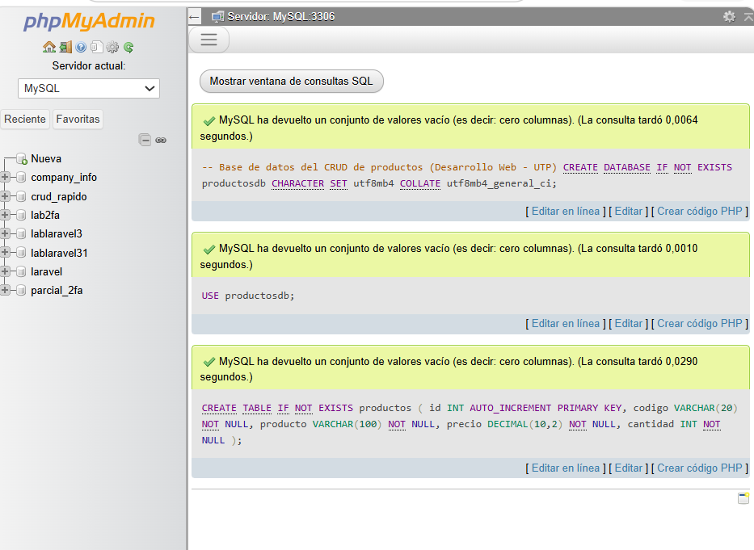</p>
<p align="center"><i>Figura 1. El script crea la base <code>productosdb</code> y la tabla <code>productos</code>.</i></p>

<p align="center">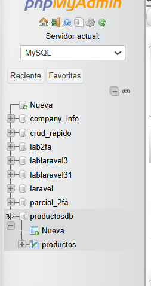</p>
<p align="center"><i>Figura 2. <code>productosdb</code> aparece en el panel izquierdo con su tabla <code>productos</code>.</i></p>

**4. Revisar la conexión.** En `Modelo/conexion.php` se configuran `HOST`, `BD`, `USER` y `PASS`. Por defecto en WAMP: `localhost`, `productosdb`, `root` y contraseña vacía.

**5. Abrir la aplicación.** Entrar a **http://localhost/CrudProductos/** (desde el servidor, no abriendo `index.html` con doble clic, porque `fetch` necesita Apache y PHP).

<p align="center">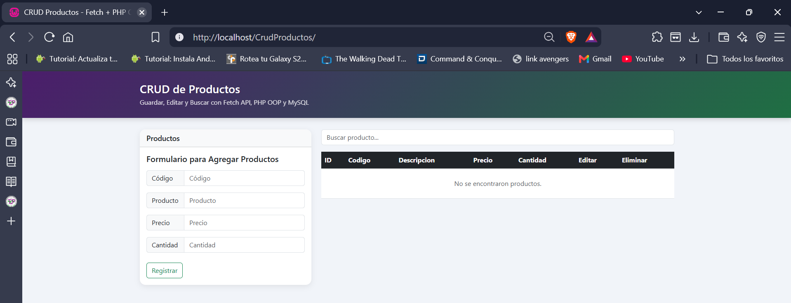</p>
<p align="center"><i>Figura 3. Pantalla inicial: formulario, buscador y tabla vacía.</i></p>

---

## 🧩 Controles utilizados

| Control | Dónde | Para qué sirve |
|---|---|---|
| `<input type="text">` | Código, Producto | Texto del producto (límite de 20 y 100 caracteres) |
| `<input type="number">` | Precio (`step="0.01"`), Cantidad (`step="1"`, `min="0"`) | Valores numéricos |
| `<input type="hidden">` | `Accion`, `idp` | Guardan la acción actual (Guardar / Modificar) y el id del producto en edición |
| `<input type="submit">` | Botón **Registrar / Actualizar** | Envía el formulario; cambia de texto según la acción |
| `<button type="button">` | **Cancelar**, **Editar**, **Eliminar** | Cancelar edición, cargar un producto al formulario, borrarlo |
| `input-group` (Bootstrap) | Campos del formulario | Etiqueta junto a cada campo |
| `card` (Bootstrap) | Formulario | Contenedor del formulario |
| `table table-dark / table-hover` (Bootstrap) | Listado | Muestra los productos |
| `alert alert-danger` (Bootstrap) | Sobre el formulario | Lista de errores de validación |
| Buscador `<input type="text">` | Sobre la tabla | Filtra por nombre o código mientras se escribe |
| Modales de **SweetAlert2** | Todo el sistema | Éxito, error, advertencia y confirmación de eliminación |

**Estructuras de control:** `switch ($_POST['Accion'])` en `registrar.php` y `switch` en `js/script.js` (validación y respuesta), además de `fetch` con `.then()` / `.catch()`.

---

## ➕ Insertar registros

Se completan los cuatro campos y se pulsa **Registrar**.

<p align="center">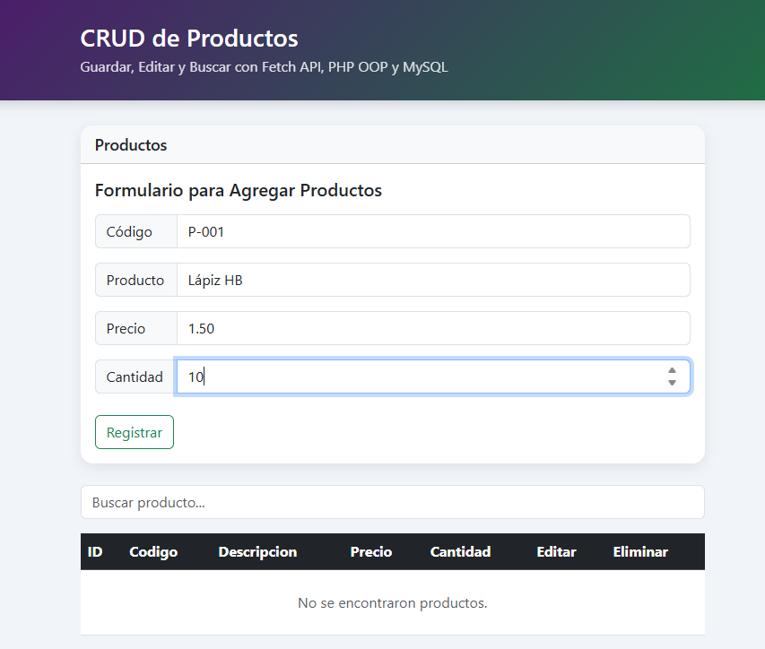</p>
<p align="center"><i>Figura 4. Formulario con los datos del nuevo producto.</i></p>

<p align="center">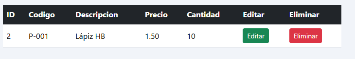</p>
<p align="center"><i>Figura 5. El producto guardado aparece en la tabla (la tabla se recarga con <code>ListarProductos()</code>).</i></p>

### ✅ Validaciones

Los datos se validan **en el cliente (JavaScript)** y **en el servidor (PHP)**. Al guardar, la cantidad mínima es 1.

<p align="center">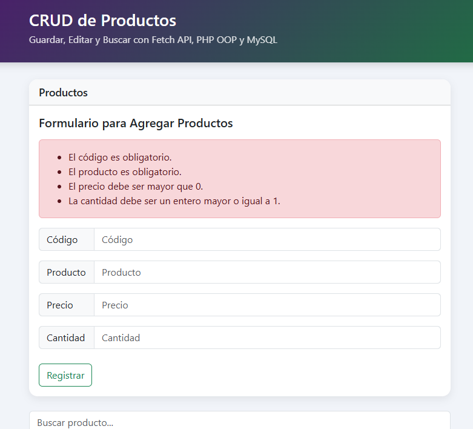</p>
<p align="center"><i>Figura 6. Validación en el cliente: el Alert de Bootstrap lista los errores.</i></p>

<p align="center">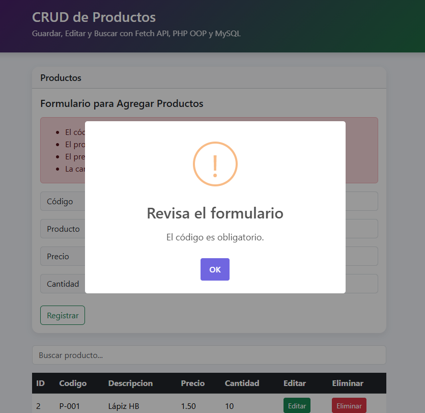</p>
<p align="center"><i>Figura 7. Validación en el cliente: advertencia con SweetAlert2.</i></p>

<p align="center">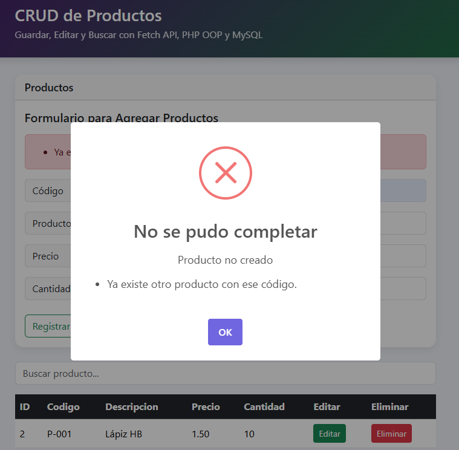</p>
<p align="center"><i>Figura 8. Validación en el servidor: PHP rechaza un código que ya existe.</i></p>

<p align="center">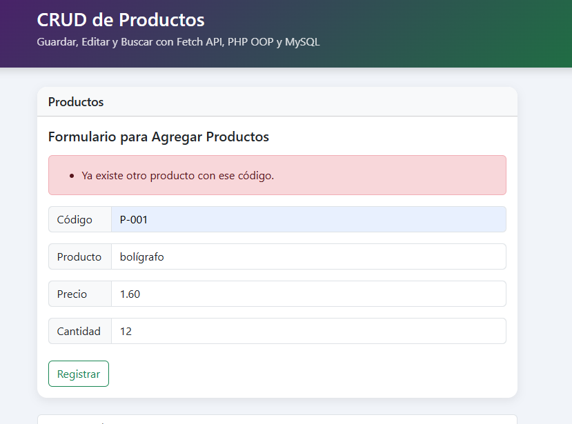</p>
<p align="center"><i>Figura 9. El error devuelto por el servidor también se muestra en el Alert de Bootstrap.</i></p>

---

## ✏️ Evidencia de acciones de Modificar

Al pulsar **Editar**, JavaScript envía `Accion=Buscar` con el `id`, `registrar.php` devuelve el producto y el formulario pasa a **modo edición** (`Accion=Modificar`, botón **Actualizar**).

<p align="center">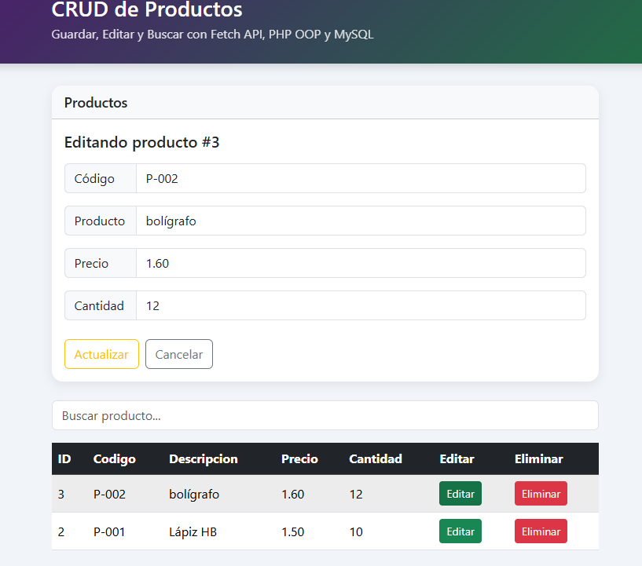</p>
<p align="center"><i>Figura 10. Formulario en modo edición («Editando producto #3»).</i></p>

Al modificar, la cantidad puede ser 0 (producto agotado), por eso el campo usa `min="0"` y la regla «mínimo 1» solo se aplica al guardar.

<p align="center">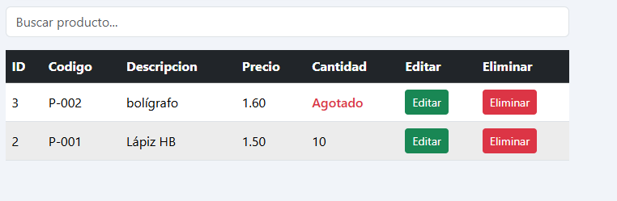</p>
<p align="center"><i>Figura 11. Resultado de la modificación: el producto con cantidad 0 aparece como «Agotado».</i></p>

---

## 🗑️ Evidencia de acciones de Eliminar

Al pulsar **Eliminar**, SweetAlert2 pide confirmación antes de borrar el registro.

<p align="center">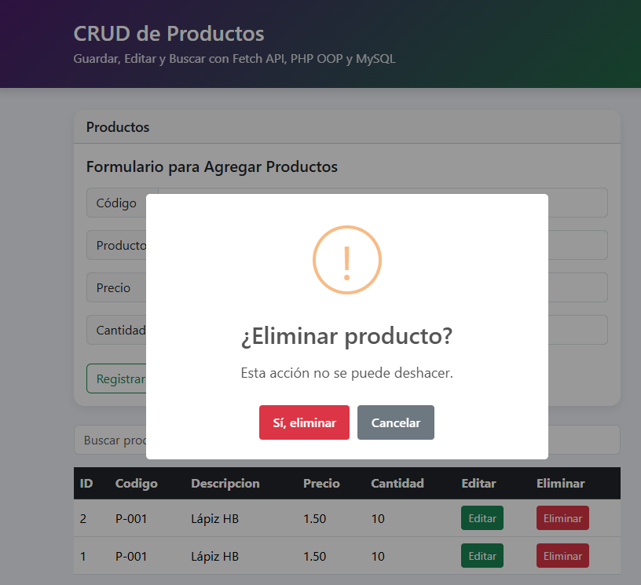</p>
<p align="center"><i>Figura 12. Confirmación de eliminación.</i></p>

<p align="center"></p>
<p align="center"><i>Figura 13. Tras confirmar, el registro eliminado ya no aparece en la tabla.</i></p>

---

## 🔍 Buscar

La caja de búsqueda envía el texto a `listar.php`, que filtra por nombre o código con una consulta preparada.

<p align="center">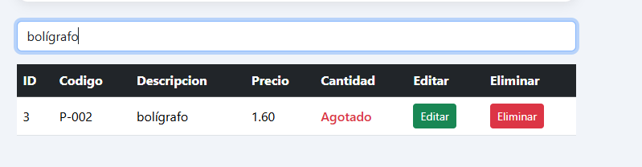</p>
<p align="center"><i>Figura 14. Búsqueda por nombre: la tabla muestra solo las coincidencias.</i></p>

---

## 📁 Estructura del proyecto y flujo

```
CrudProductos/
├── index.html                      Formulario + tabla (Bootstrap + SweetAlert2)
├── js/script.js                    submit, FormData, fetch, switch, SweetAlert2
├── registrar.php                   Enrutador: switch ($_POST['Accion'])
├── listar.php                      Devuelve las filas <tr> de la tabla (búsqueda)
├── Controlador/
│   └── ProductoController.php      guardar(), modificar(), buscar(), eliminar()
├── Modelo/
│   ├── conexion.php                Clase DB (PDO): insertSeguro, updateSeguro, query
│   ├── Productos.php               Clase Producto: validar, guardar, editar, buscarPorId, listar
│   └── SanitizarEntrada.php        Limpieza de textos
├── sql/productosdb.sql             Base de datos y tabla
└── docs/capturas/                  Imágenes usadas en este README
```

**Flujo de una petición:**

```
index.html ─► js/script.js (valida, FormData, fetch)
          ─► registrar.php (switch Accion)
          ─► ProductoController ─► Producto ─► DB (PDO)
          ─► JSON { success, message, accion, errors }
          ─► SweetAlert2 + ListarProductos() recarga la tabla
```

**Seguridad:** consultas preparadas con PDO (evita inyección SQL), limpieza de entradas, validación en cliente y servidor, y escape de HTML al mostrar datos.

---

## 👥 Detalles del autor, fecha y referencias

### Autores
| Integrante | Rol |
|---|---|
| **Jazid Sánchez** | Estudiante — Desarrollo Web, UTP |
| **Nohelis Castro** | Estudiante — Desarrollo Web, UTP |

- **Instructora:** Ing. Irina Fong
- **Grupo:** 1S3122
- **Fecha:** 24 de noviembre de 2026

### Referencias
- Fong, I. (2026). *Guía de Laboratorio Práctico: CRUD – API Fetch y MySQL (Guardar, Editar, Buscar)* y presentación *Documentación de Fetch*. Universidad Tecnológica de Panamá.
- Repositorio de ejemplos de la instructora: https://github.com/Salomon2514/EjemplosFetch
- Video guía de la asignación: https://youtu.be/AXZGTOd8ASk
- MDN Web Docs. *Fetch API*: https://developer.mozilla.org/es/docs/Web/API/Fetch_API
- MDN Web Docs. *FormData*: https://developer.mozilla.org/es/docs/Web/API/FormData
- PHP Manual. *PDO*: https://www.php.net/manual/es/book.pdo.php
- PHP Manual. *json_encode*: https://www.php.net/manual/es/function.json-encode.php
- Bootstrap 5.3. Documentación: https://getbootstrap.com/docs/5.3/
- SweetAlert2. Documentación: https://sweetalert2.github.io/
